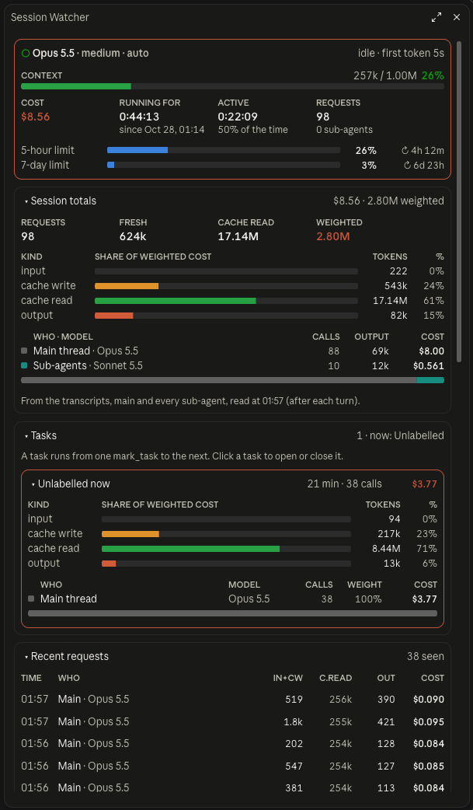

# Session Watcher

A Claude Code mod that shows one pane with everything about the current session. It combines the token-use mod with ideas from [Flightdeck](https://github.com/scasella/claude-flightdeck).

<p align="center"></p>

## Install

At the prompt of a Claude Code terminal session:

```
/plugin install session-watcher --marketplace machinataph-hash/session-watcher
```

Answer `y` to add the marketplace, then pick a scope. From a shell:

```sh
claude plugin install session-watcher --marketplace machinataph-hash/session-watcher
```

It needs `python3` on your PATH for the session totals and active time.

## Use

Open it with `/session-watcher`. Close it with `/session-watcher close`. `/session-watcher reset` puts the sections back to how they start.

## What it shows

Each section opens and closes when you click its title. Vitals is always shown. Session totals and Tasks start open. The other sections start closed.

| Section | Shows |
| --- | --- |
| Vitals | model, effort, permission mode, how full the context is, compactions, cost, how long the session has run and been active, rate limits with time to reset, time to first token |
| Session totals | every request in the session, main thread and sub-agents, read from the transcripts after each turn; token kinds; cost split by who made the request and which model |
| Tasks | token use and cost per task. A task runs from one `mark_task` call to the next. |
| Recent requests | the last 15 model requests: who made them, the model, the tokens and the cost |
| Sub-agents | each sub-agent: whether it is running, how many steps it has taken, its context size, its output, its last tool call |
| Permissions | permission checks allowed, asked and denied, by kind of tool, plus the latest checks |
| Last turn | how long it took, cost added, tool calls, edits, errors |
| Activity | prompts, sub-agent starts and finishes, edits, errors, denials, compactions |

## How cost is worked out

The session cost is Claude Code's own total. Each row's cost is its tokens priced at list price, then scaled so all the rows add up to that total.

## Files

- `hooks/register.tsx`: the event hooks and the pane
- `hooks/core.ts`: prices, sums and formatting
- `hooks/scan.py`: reads the session's transcripts for totals and active time
- `hooks/pane.test.tsx`: tests, run with `claude plugin test .`
