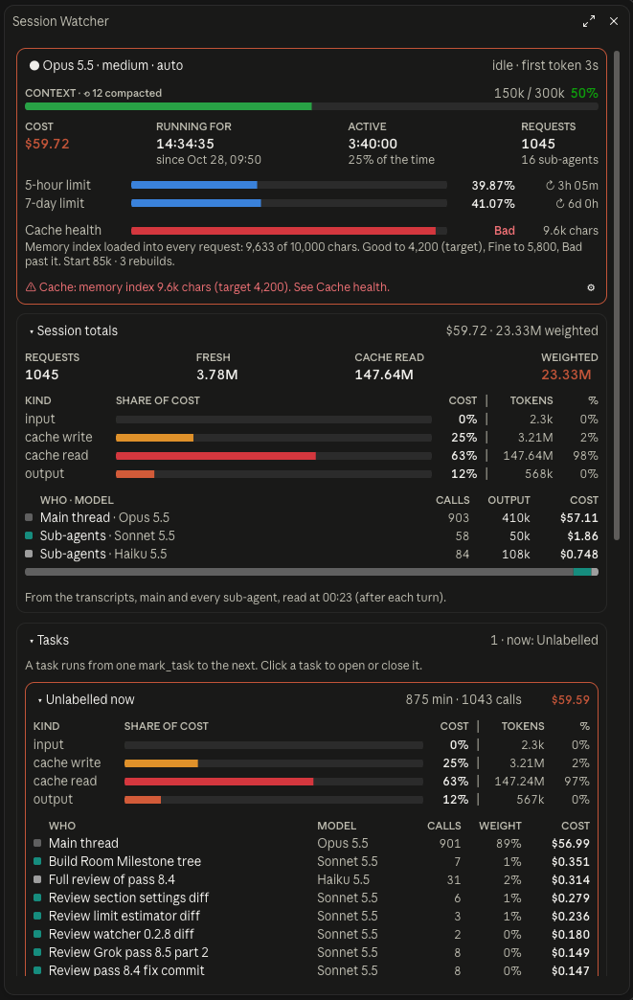
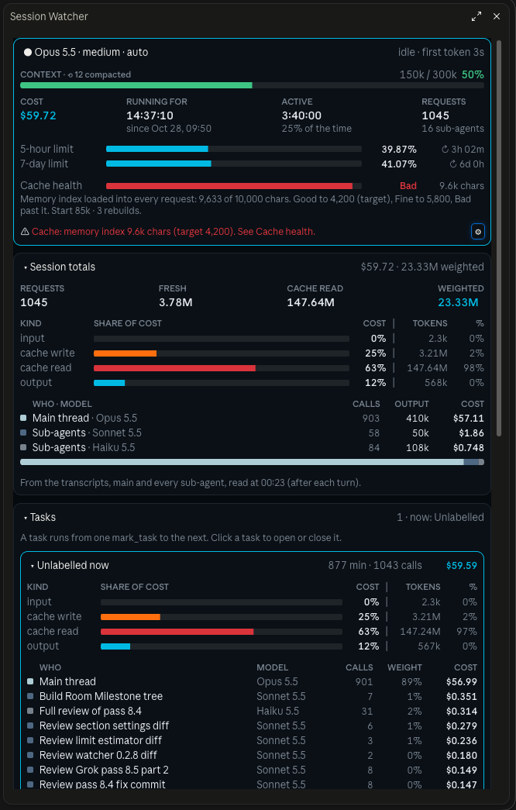
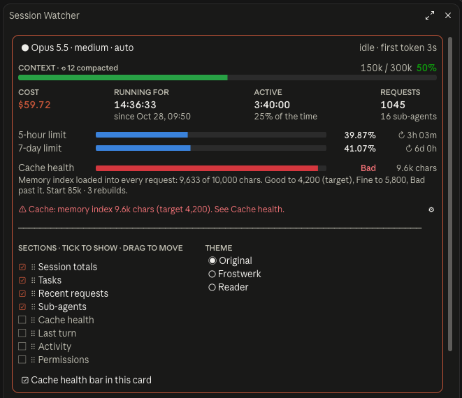
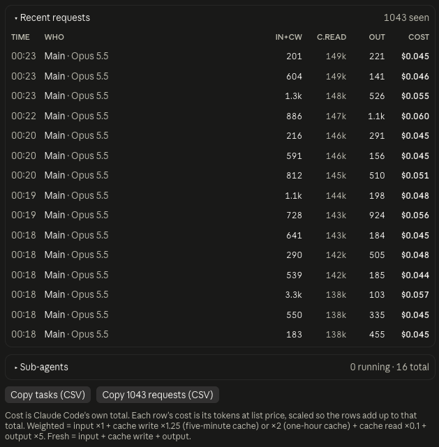

# Session Watcher

**A Claude Code mod that puts your session's cost, tokens and activity in one pane**: context and rate limits, Claude Code's own cost, token use for the whole session, per task and per request, your sub-agents, every permission check, and a log of what happened. Every number comes from a real session event or the session's own transcript, and nothing leaves your machine except the live page it publishes to your own claude.ai account (`/session-watcher live off` stops it).

It builds on the token-use mod and takes ideas from [Flightdeck](https://github.com/scasella/claude-flightdeck).

<p align="center">
  
  
</p>
<p align="center"><sub>The Original theme (left) and Frostwerk (right).</sub></p>

## Design

The layout follows a short set of written rules: [docs/DESIGN.md](docs/DESIGN.md). Tests check every rule on every card.

## Install

At the prompt of a Claude Code terminal session:

```
/plugin install session-watcher --marketplace machinataph-hash/session-watcher
```

Answer `y` to add the marketplace, then pick a scope. From a shell:

```sh
claude plugin install session-watcher --marketplace machinataph-hash/session-watcher
```

It needs `python3` on your PATH for the session totals and active time. Mods are an early-access Claude Code feature, and their API can change between releases.

## Use

| Command | Does |
| --- | --- |
| `/session-watcher` | open the pane |
| `/session-watcher close` | close it |
| `/session-watcher reset` | put every section back to its starting open or closed state |
| `/session-watcher report` | publish the live page now |
| `/session-watcher live on` / `off` | turn the live page on or off (on by default) |
| `/session-watcher live 20` | publish at most every 20 seconds (the default; 5 at the least) |

Click a section's title to open or close it. The top card is always shown. Session Totals and Tasks start open, and the rest start closed, so you choose what you see. The pane opens by itself when a session starts.

## What you see

| Section | Shows | From |
| --- | --- | --- |
| **Main** (always shown) | a summary: model, effort and permission mode; whether a turn is running; a context bar measured against the window the session compacts at (`autoCompactWindow` in settings, else the model's window), amber at 65% and red at 85% by default, with the compaction count; COST, RUNNING FOR, REQUESTS and COST / REQUEST (session cost ÷ requests, both from the same transcript read), a row that pressing the model's name folds away; the 5-hour and 7-day limits with time to reset. The engine gives whole percents, so once two percent steps have been measured each limit shows a two-decimal estimate (`37.42%`): the spend since the last step divided by the median dollars per percent of the last five steps, counted across every session that runs the mod (kept in the mod's store). Spend the mod does not see (claude.ai, other machines) makes it run low. One warning line when the memory index is past its target. Extras in its ⚙: ACTIVE time and its share, first-token time. Weighted tokens are never shown here | `turn.step`, `session.measure`, `session.compact`, `$.session.usage()`, the transcript |
| **Settings** (the ⚙ at the bottom right of Main) | three labelled groups that sit side by side when wide and stack when narrow: **Cards**, a chip per card: tick it to show or hide that card, drag it to move it (on mobile, an ↑ moves it up a place); **Main card**, its extras; **Theme**: **Original** (the app's own colours), **Frostwerk** (dark, from Blueprint's Frostwerk brand) or **Reader** (light paper colours). Every other card has its own small ⚙ in its title row for its extras. The layout, theme, targets and each card's extras are kept for later sessions | the mod's store |
| **Session Totals** | where the money went, every number from one transcript read: the TOTAL at that read (marked UPDATING while the live cost has moved past it, so the parts below always add up to the total shown); MAIN THREAD and SUB-AGENTS cost, each with its cost per request; cost by kind of token (input green, cache write amber, cache read red, output orange); cost by who made the request and which model. Extras: token counts (fresh, cache read, WEIGHTED tokens, token columns and each who/model row's WEIGHT share; on by default), the two CSV buttons | the transcripts, read again after each turn |
| **Tasks** | one card per task (a task runs from one `mark_task` call to the next): its time, requests, cost, kinds of token, and who spent them with their WEIGHT share. Extras: the how-it-works line, cost by kind in each task | `turn.step` |
| **Recent Requests** | the last 15 model requests: time, who, model, cost. Extra: the token columns (input and cache write, cache reads, output) | `turn.step` |
| **Sub-Agents** | SUB-AGENTS (one count: every sub-agent this session, with how many are running), their COST and its share of the session, COST / REQUEST; then each running sub-agent: its task, type, model, steps, context size, output, run time, last tool call. Extras: cost by type and model, the finished sub-agents (on by default) | `agent.spawn`, `turn.step`, `tool.call`, `turn.complete`, the transcripts |
| **Permissions** | checks allowed, asked and denied, by kind of tool (file, shell, web, agent, other), and a bar of the mix. Extra: the latest 6 checks with secrets masked | `tool.check` |
| **Cache** (closed at first) | CACHE HIT RATE (cache reads ÷ all input: uncached input + cache writes + cache reads, for the session), the starting load (the context of the session's first request), rebuilds, and the memory index as a bar out of 10,000 characters (by default Good up to the 4,200 target, Fine up to 5,800, Bad past that). Extras: the rebuild list (main-thread requests writing over 50k, each labelled session start, after a summary, idle over 1 hour, or other), the 10 largest tool results. Its ⚙ also holds the targets (below) | the transcripts |
| **Last Turn** | how long it took, the cost it added, tool calls, edits, errors, sub-agents started, and the turn's cache hit. Extra: requests this turn (red past 15 by default) | `turn.start`, `tool.call`, `turn.complete` |
| **Activity** | your prompts (first 70 characters), sub-agents starting and finishing, edits, failed tool calls, denials, compactions. Extra: info lines (off shows errors and finishes only) | all of the above |

Two buttons in Session Totals (an extra, on by default) copy the task summary and the full request log (up to 5,000 requests) as CSV.

### Cache targets

Each row in the Cache card's ⚙ → **Targets** has a − and a + that move it one step. The three memory rows are counted in characters of the memory index. The four percent rows are for two different bars, the context bar and the plan-limit bars, which measure their own percent of a fixed total. So those percents cannot be worked out from the memory rows.

| Row | Default | Step | What − and + change |
|---|---|---|---|
| Memory index: good to | 4,200 | 200 | the memory index bar is green up to this many characters |
| Memory index: fine to | 5,800 | 200 | orange up to this many; red past it |
| Memory index: bar width | 10,000 | 1,000 | how many characters the full bar stands for. A longer index fills it |
| Context: orange from % | 65 | 5 | the CONTEXT bar turns orange at this percent full (of the point where the context is compacted, when known; else of the whole window) |
| Context: red from % | 85 | 5 | and red at this share |
| Plan limits: orange from % | 60 | 5 | the 5-hour and 7-day limit bars turn orange at this percent used |
| Plan limits: red from % | 85 | 5 | and red at this percent |
| Requests per turn: limit | 15 | 1 | REQUESTS in Last Turn turns red past this many |

No row has an upper end. A row stops at its floor (200 for good, 400 for fine, 1,000 for bar width, 5 for orange, 10 for red, 1 for requests), and never goes below the row it pairs with: good stays under fine, fine stays at or under the bar width, and orange stays under red. Raising the lower row of a pair carries the upper one up with it, and lowering it again brings the upper one back. A value that differs from its default is shown bold. **↺ Back to the defaults** resets every row.

<p align="center">
  
  
</p>

It fits the space it has. On a wide pane, each row of figures spreads from edge to edge. On a narrow pane, rows drop their less important columns and the bars get shorter. The terminal draws bars as block characters, and the desktop app draws them as SVG.

## Tasks and `mark_task`

The mod adds a tool, `mark_task`. When Claude calls it with a label (for example "A2 build"), every later request from the main thread and from sub-agents counts toward that task until the next call. The tool returns the totals of the task that just ended. A sub-agent stays with the task it started under. A call to token-use's own `mark_task` starts a task here too, so the two mods stay in step.

A second tool, `context_breakdown`, returns the context window broken down as `/context` shows it: each category, the tokens of each MCP server's tools (loaded and deferred apart), the memory files, agents, skills and slash commands. It is a deferred tool, so it adds only its name to each request until it is used.

## How the numbers are worked out

- **Session cost** is Claude Code's own total, the one `/cost` shows.
- **The cost of a row, task or request** is its tokens priced at list price, then scaled so the rows add up to Claude Code's total. The list prices are only used as ratios between models. Fable is priced like Opus until its price is known.
- **Session Totals** come from the transcripts, the main one and each sub-agent's. A response is written there as several lines that repeat its usage, so each response is counted once, by its message id. This also counts requests made before the mod was loaded.
- **Weighted** = input ×1 + cache write ×2 (one-hour cache) or ×1.25 (five-minute cache) + cache read ×0.1 + output ×5. Each response says how many of its writes went to each cache; where a response does not (in the transcript or a `turn.step` record), or claims more one-hour writes than writes, main-thread writes count as one-hour (capped at the writes) and sub-agent writes as five-minute, which is how Claude Code sets them on a subscription. These are the price ratios, so weighted tokens compare cost, not volume. **Fresh** = input + cache write + output: the tokens paid at full price.
- **Active time** is time with a turn running, read from the transcript: from a prompt to the main thread's end of turn. Sub-Agents run inside a turn, so they add no time of their own.
- **Time to first token** is timed at the mod's own hook, so it includes the network and anything else that runs before the response's first piece. When thinking isn't streamed, it includes the thinking.

## What is estimated, not measured

- Per-row cost, as above: Claude Code reports one total, not a cost per request.
- Tasks, recent requests and sub-agent cards only count what happened while the mod was loaded. Session Totals count the whole session.
- Session Totals update after each turn, so during a long turn they trail the live task count.
- A sub-agent's context size is the whole input of its latest request.

## Live page

Session Watcher also publishes the pane as a private page on claude.ai, so you can follow a session where the pane can't be drawn, such as a cloud session in the desktop app. After each model request it writes its state into [`report/page.html`](report/page.html) and publishes it with the Artifact tool, at most once every 20 seconds; requests inside that wait are published when it ends, so the page never stays behind. The first publish puts the link in Activity and in a toast; later ones update the same page, and an open page picks up the update by itself.

A publish is a tool call the mod makes itself, not a model request, so it costs no tokens. The page shows the same cards as the pane, drawn to [docs/DESIGN.md](docs/DESIGN.md), with the pane's own numbers: cost, context, rate limits, permissions and sub-agents. Which cards are open, their extras and the theme are kept in your browser. The page is private until you share it, and its Activity and Permissions cards show your prompts and commands.

Change the page in `report/page.src.html` (or `hooks/core.ts`), then rebuild it with `node report/build.mjs`. `node --experimental-strip-types report/export.ts <session id> <folder>` rebuilds a session's state from its transcripts, for a page of a session that ran without the mod; `node report/build.mjs --preview <folder>/state.json` writes `report/preview.html` to look at.

## What it can reach

Session Watcher only watches. Every hook passes its event on unchanged: it never denies, rewrites or delays a tool call, a prompt or a sub-agent. If its own bookkeeping fails, the event still passes through.

| It sees or does | Through |
| --- | --- |
| model requests and their token usage | `turn.step` |
| tool calls (name, path or command), whether they failed | `tool.call` |
| permission verdicts | `tool.check` |
| sub-agent starts and finishes | `agent.spawn`, `turn.complete` |
| your prompts' first 70 characters, for the activity log | `turn.start` |
| context, cost and rate limits | `session.measure`, `$.session.usage()` |
| runs `python3 hooks/scan.py`, which reads this session's own transcripts under `~/.claude/projects` | `$.process.run` |
| copies CSV to your clipboard when you press a button | `$.ui.copy` |
| writes the live page under `~/.claude/session-watcher/live/` and publishes it | `$.fs.write`, `$.tool.call` (Artifact) |

What it keeps lives in session state and ends with the session. It makes **no** network requests of its own and calls no model. The only file it writes is the live page, and the only tool it calls is Artifact to publish it; `/session-watcher live off` stops both. Paths are shortened and anything that looks like a key or token is masked before it is shown. `claude plugin validate .` lists exactly what it hooks and calls.

## Troubleshooting

- **The pane doesn't open:** check `claude --version` is 2.1.308 or later, then run `/reload-plugins` and `/session-watcher`. Look in the transcript for a dim line starting `session-watcher:`; it names what failed.
- **`/session-watcher` isn't in the `/` menu:** type it in full. Some surfaces list a mod's commands only after it has loaded.
- **Cloud session in the desktop app says "no-surface":** the app doesn't draw mod panes there; use the live page (`/session-watcher report`). To load a new version in a cloud session, start a new session: restarting the app reconnects to the same one, and `/reload-plugins` isn't available over a remote connection.
- **Keep the page handy:** pin it to the claude.ai sidebar from the page, or ask Claude to pin it.
- **No live page link:** look in Activity for a `page` line. `publish failed` says why; the Artifact tool has to be available in the session.
- **Session Totals stay at 0 or say "Reading the transcripts…":** check `python3` is installed and on your PATH.

## Files

| File | Holds |
| --- | --- |
| [`hooks/register.tsx`](hooks/register.tsx) | the event hooks and the pane |
| [`hooks/core.ts`](hooks/core.ts) | prices, sums and formatting, as plain functions |
| [`hooks/scan.py`](hooks/scan.py) | reads the session's transcripts for totals and active time |
| [`hooks/pane.test.tsx`](hooks/pane.test.tsx) | 48 tests: the section chips (hide, drag, a saved layout), each card's extras (stored only when changed, old fields dropped), the settings reflow at a narrow width, Session Totals adding up to one snapshot, the themes (kept, unknown ones dropped, every nested element painted), the limit estimator, drawing, opening and closing sections, folding the Main stats row (terminal and desktop), permission tallies, the context limit, cache-write pricing by cache length, the Cache card and its Main warning line (memory index, cache hit rate), every width from 24 to 120 columns on the terminal and the desktop, and the `context_breakdown` text |
| [`hooks/live.test.tsx`](hooks/live.test.tsx) | the live page: a request publishes the state, later ones wait for the interval and the last is not lost; off, report, and the kept setting |
| [`hooks/scan_test.py`](hooks/scan_test.py) | `python3 -I hooks/scan_test.py`: transcript reading — one-hour writes when a response has no split, the cap at the write, empty placeholder lines skipped, two responses in the same millisecond, rebuild labels, a session whose transcripts sit in several project folders |
| [`report/page.src.html`](report/page.src.html) | the live page; `report/build.mjs` bundles `core.ts` into [`report/page.html`](report/page.html) |
| [`report/export.ts`](report/export.ts) | a session's state rebuilt from its transcripts, for a page without the mod |
| [`types/index.d.ts`](types/index.d.ts) | the state contract |

## Develop

```sh
claude --plugin-dir .            # load it; edits reload
claude plugin validate .
claude plugin test .
```

## License

[MIT](LICENSE)
